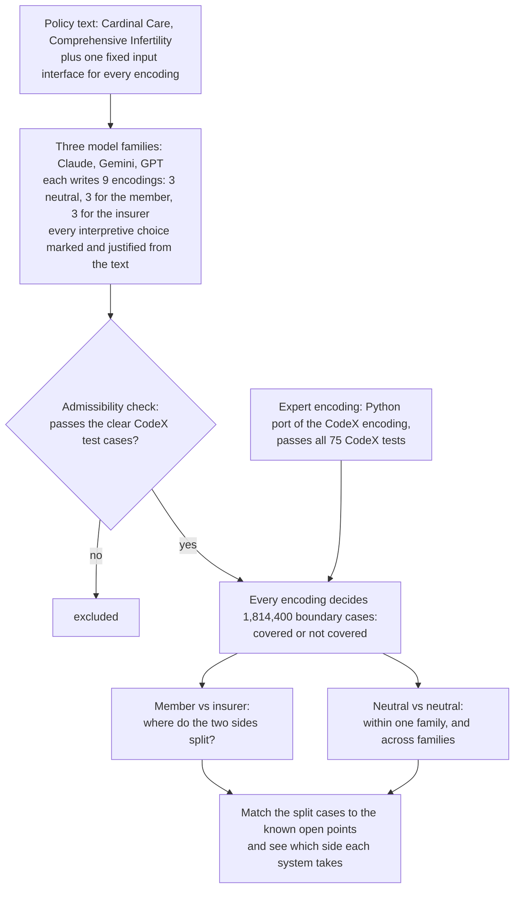

# What Disagreement Cannot See: pilot tests (October 2026)

Pilot experiments behind a sharpened master's thesis exposé on LLM formalizations of insurance coverage rules,
using the CodeX Insurance Analyst (Stanford Cardinal Care, Comprehensive Infertility coverage) and the disagreements
released with Vernie and Grabmair, "By Their Fruits You Will Know Them" (EMNLP 2026).

Author: Mert Ayvazoglu (TUM). All model outputs are kept.

## The main experiment in one minute (`kA/`)

Current models translate the coverage rule correctly. What they still differ on are **readings**: points where the
policy text does not decide the case. The experiment asks how to find those points, and how AI systems fill them.

| What was compared | Claude | Gemini 3.8 Flash | GPT-6.1 Sol and GPT-6 Astra |
|---|---|---|---|
| Member vs insurer: cases where they split | 37,692 | 54,754 | not measurable: every member encoding failed the admissibility check |
| Known open points among the split cases | 4 of 6 | 5 of 6 | |
| Neutral vs neutral within the family: cases where they split | 3,132 | 0 | 0 |

Neutral encodings of different families split on 39,700 cases, on the same open points (descriptive, not
pre-registered). So asking one model again shows almost none of the readings; asking for opposite sides, or asking
another model family, shows them.

**One case.** A 34-year-old man without a partner, with two abnormal semen analyses two weeks apart. The glossary
defines him as infertile, but the eligibility table has no row for him.

| Who decides | Outcome |
|---|---|
| Expert encoding (CodeX) | not covered |
| Insurer encodings, all families | 0 of 9 cover |
| Member encodings, all families | 8 of 9 cover (counting the GPT member encodings that failed the check) |
| Neutral encodings | Claude 3 of 3 cover; Gemini 0 of 3; GPT 0 of 3 |

**Terms.** *Encoding*: a program that takes a claim and returns covered or not covered. *Reading*: one way of
resolving a point the text leaves open. *Open point*: such a point; six were known in advance from the CodeX
encoders' notes and earlier pilot runs. *Admissibility check*: an encoding must pass the CodeX test cases that do not
depend on an open point, so a side cannot simply cover or deny everything.

Details, pre-registration and the GPT failure: `kA/FINDINGS.md`. Cross-family numbers: `kA/results/crossfamily.md`.

## Tests, in order

| Folder | Question | Result |
|---|---|---|
| `PILOT_REPORT.md`, `src/`, `results/` | Do current models still make the encoding errors the exposé targeted? | No: guided encodings near perfect; Kant et al.'s vanilla benchmark 0.78 to 0.88 (2024 models) vs 0.90 to 0.99 now; residual divergences sit on points the text does not settle |
| `k9/` | Are outcome changes between two policy versions (Aetna 2023-24 vs Wellfleet 2025-26) visible from the text? | Yes: a blind model reader predicted them as well as enumeration (dead as framed) |
| `k1proxy/` | Do readers agree that an item is undetermined? | Lay readers rarely abstain (4.2% "can't decide"); ambiguity shows as split readings |
| `k2/` | Does one prompt find the interpretive choices recorded for the expert encoding? | Yes: 7 of 7 in 3 of 3 runs (GPT-6 Astra), among 55 to 62 flagged points |
| `c11check/` | Is the released `legal_ambiguity` label stable across recurrences? | Pairwise agreement 0.56 vs 0.51 by chance (small n, preliminary) |
| `k15/`, `k15ctx/` | Do legal sources settle the released disagreements, and does supplying them change a model's reading? | Sources address 23 of 30 sampled points (mapping by an LLM agent, not a lawyer); a model picks the source's reading without seeing it (16 of 16) |
| `k4/`, `k4b/` | Does a coverage agent ask for the right facts and notice when an answer depends on a reading? | Facts: yes. Readings: silent in 6 and 8 of 24 (pre-registered 30% bar missed in run 1); the encoders' own "we're assuming" gap silent in 8 of 8; with an automatic list of readings, 0 of 24 |
| `kA/` | Do encodings written for the member and for the insurer reveal readings that neutral encodings share? | Claude: diverge on 37,692 of 1,814,400 grid cases, on 4 of 6 representable known points; Gemini 3.8 Flash replicates (54,754 cases, 5 of 6); GPT-6.1 Sol and GPT-6 Astra fail as pre-registered (every member encoding takes a reading of "you or your partner" that two CodeX tests reject; a first GPT run stopped at an enrollment field the interface lacks). Within a family neutral encodings barely disagree (Claude 3,132 cases, Gemini and GPT 0); across families they differ on 39,700 cases on the same points (descriptive, not pre-registered). Grid built around the known points |

Folders `k2/`, `k4/`, `k4b/`, `k9/`, `k15ctx/` and `kA/` contain a `PREREGISTRATION.md` written before the runs it covers;
results are in `FINDINGS.md`, `results/VERDICT.md` or `results/scoring.md`. The repository was created on 2026-10-17
after the runs, so the git history does not timestamp the pre-registrations; the dates in the files do.
Corrections made after red-team reviews are recorded in the findings files themselves.

## What these results point to
Translation of the coverage is at ceiling; what remains are readings: points the policy text does not settle. Within
one model family they are nearly fixed, so sampling one model again shows few of them; different families settle some
of them differently. Encodings written for opposite sides, or by other model families, reveal them. Three questions
follow:
1. Where does an encoded rule leave room for the parties? Encoded for each side under an admissibility floor (the
   clear CodeX test cases, departures justified from the text), where do the encodings diverge on a grid of
   boundary cases, which side does each reading favour, and how much does disagreement within one model, or across
   families, miss?
2. Which of those points does the text, case law, official guidance or the insurer's recorded answer settle?
3. Which way do the expert encoding, different model families and a coverage agent resolve the points nothing settles, and
   what should an answer tell the member?

## Not included (third-party material, fetch it yourself)
- CodeX encoding and reference documents: https://github.com/codexstanford/cardinal-care-encoding (no licence
  declared). Clone into `data/cardinal-care-encoding/`. The Python port of the expert encoding (`src/expert.py`), which
  the scripts import, is not published here because the original carries no licence; it is available on request.
- Policy text excerpts used in prompts come from that repository's reference documents (Aetna, Cardinal Care 2023-24)
  and from the Wellfleet 2025-26 master policy (https://myahpcare.com/wp-content/uploads/Stanford_Master-Policy_25-26.pdf).
- LegalBench `insurance_policy_interpretation` (CC BY 4.0) and its raw crowd votes
  (github.com/madiganbrodsky/vague_contracts, no licence stated).
- Vernie and Grabmair's release: Zenodo record 22128911 (MIT), `verbalizations.jsonl.gz`.
- Raw API logs and prediction caches (large, and they contain the third-party texts above).

## Limits
Pilot scale. Test messages in `k4/` and `k4b/` and the encodings in `kA/` were generated by an LLM from written specifications; judges were
mostly one model family (Claude); `kA/` was run with three families (Claude, Gemini, GPT); scoring rules and their
deviations are documented in each findings file.
